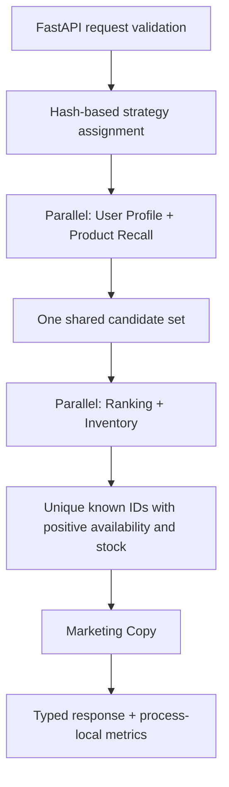

# Multi-Agent E-Commerce Recommendation & Marketing System

A Python system for coordinating user profiling, product recommendation, inventory rules, and personalized marketing copy. It combines FastAPI, asynchronous agent execution, and a LangGraph workflow around a small synthetic product catalog.

The application runs **offline by default**, with deterministic model substitutes and no API key or storage service required. Its engineering focus is safe workflow composition: shared candidates, fail-closed inventory filtering, explicit concurrent state updates, bounded agent execution, and testable recommendation strategies.

**Project status:** verified offline prototype. Live model integration, external storage, and container deployment have not been runtime-verified. The upstream README states MIT permission, but the formal license file is missing; see [licensing status](docs/LICENSE_STATUS.md) before redistribution.

## Architecture



Two endpoints execute the same stage methods: a direct asynchronous supervisor and a compiled LangGraph graph. The supervisor implements a fixed workflow; it does not use an LLM to choose agents or tools. LangGraph stages use `asyncio.gather` internally and return explicit state updates, avoiding shared nested-state mutation and stale snapshot overwrites.

| Agent | Implemented behavior | Boundary |
|---|---|---|
| User Profile | Parses segments, category preferences and price range from model output | Uses supplied context or synthetic behavior defaults; offline profiles are fixed synthetic examples |
| Product Recommendation | Recalls mock catalog candidates; applies category preference rules or model-based ID reranking | No trained collaborative filtering, embeddings or vector search |
| Inventory | Checks stock fields, flags low stock and suggests purchase limits | No live warehouse query, stock reservation or checkout enforcement |
| Marketing Copy | Selects one of five segment templates, validates output IDs and applies a forbidden-word mask | Model generation is synthetic offline; masking is not a legal compliance guarantee |

Inventory and ranking receive the same candidates. Empty availability or inventory failure produces an empty product list. Ranking failure can fall back to recalled products only through the positive inventory gate. Unknown or duplicate ranking IDs cannot introduce unchecked products. The pipeline may return fewer products than requested.

Agent deadlines include execution, retry attempts and backoff. Errors become sanitized failed results; cancellation by the caller propagates. Raw model responses are not included in API result data.

## Installation

Use **Python 3.12.14** and `uv`. From the repository root:

```bash
uv sync --project python --frozen
```

`python/uv.lock` records exact dependency versions and package hashes. Initial installation downloads packages; it does not call an LLM or start a service. A cached environment can use `--offline`.

For runtime-only installation with pip:

```bash
python3.12 -m venv .venv
source .venv/bin/activate
python -m pip install --require-hashes -r python/requirements.lock.txt
```

The hash-pinned export is used by Docker too. `python/requirements.txt` points to that export; development tools are included by `uv sync`.

## Offline demo

```bash
uv run --project python --frozen uvicorn main:app \
  --app-dir python --host 127.0.0.1 --port 8000
```

No `.env`, provider key, Redis, Milvus or database server is required. The offline model returns synthetic profiles, catalog order and example copy; this demonstrates workflow behavior rather than recommendation quality.

```bash
curl http://127.0.0.1:8000/health

curl -X POST http://127.0.0.1:8000/api/v1/recommend \
  -H 'Content-Type: application/json' \
  -d '{"user_id":"demo","num_items":3,"context":{"recent_views":["手机"]}}'

curl -X POST http://127.0.0.1:8000/api/v1/recommend/graph \
  -H 'Content-Type: application/json' \
  -d '{"user_id":"demo","num_items":3}'
```

Both recommendation routes return a request ID, products, marketing copies, experiment group, five agent results, latency and timestamp. Requests require a 1–128 character `user_id` and 1–50 `num_items`. `scene` is metadata and does not currently choose behavior. `/docs` exposes the generated OpenAPI interface.

| Endpoint | Purpose |
|---|---|
| `GET /health` | Application health and active model mode; not dependency readiness |
| `POST /api/v1/recommend` | Direct supervisor workflow |
| `POST /api/v1/recommend/graph` | Compiled LangGraph workflow |
| `GET /api/v1/experiments` | Experiment groups, counters and serving status |
| `POST /api/v1/experiments/{experiment_id}/outcome?group=control&success=true` | Local synthetic posterior update; unknown experiment/group returns 404 |
| `GET /api/v1/metrics` | Process-local agent call statistics and business-event summaries |

The API is an unauthenticated local development interface. The outcome endpoint does not verify exposure attribution or deduplicate events.

## Recommendation experiments

`rec_strategy` uses weighted consistent hashing. Its configuration selects actual ranking behavior:

- `control`: deterministic category preference ranking, without a ranking model call.
- `treatment_llm`: model reranking when a valid profile is available; otherwise rules.

Both API paths use the same experiment engine. Setting `ECOM_AB_TEST_ENABLED=false` forces the rule-based control strategy.

Thompson Sampling is implemented and tested as a **standalone experimental helper**, with injectable randomness and Beta-posterior updates. It is not the serving assignment policy, does not maintain sticky user assignments, and has no durable or authenticated outcome history. The registered `copy_style` experiment is also experimental and is not wired to template selection. No uplift or production traffic optimization is claimed.

## Configuration

`python/.env.example` contains safe defaults and an empty key. Settings load `.env` from the current working directory. For the root-level command above, an optional private `.env` belongs at the repository root. Environment variables override file values.

| Variable | Default / meaning |
|---|---|
| `ECOM_LLM_MODE` | `offline`; `live` explicitly enables a provider client |
| `ECOM_LLM_API_KEY` | Empty; live mode rejects empty/placeholder keys |
| `ECOM_LLM_BASE_URL`, `ECOM_LLM_MODEL` | Retained upstream MiniMax defaults; provider compatibility unverified |
| `ECOM_AB_TEST_ENABLED` | `true` |
| `ECOM_AB_TEST_DEFAULT_BUCKET_COUNT` | `100`, positive integer |
| `ECOM_AGENT_TIMEOUT_USER_PROFILE` | `5` seconds |
| `ECOM_AGENT_TIMEOUT_PRODUCT_REC` | `8` seconds |
| `ECOM_AGENT_TIMEOUT_MARKETING_COPY` | `10` seconds |
| `ECOM_AGENT_TIMEOUT_INVENTORY` | `5` seconds |

Redis, Milvus and database settings are reserved for future serving integrations. The Redis FeatureStore helper remains available, but no client is connected by the default application. Global LLM temperature/token settings are retained; agents currently specify their own values.

Live mode may send user context and product information to the configured provider and incur charges. It was not exercised for this release. Keep real keys out of source, logs and uploads; do not use real personal data in this local demo. See [security and privacy](docs/SECURITY.md).

## Tests and validation

```bash
uv run --project python --frozen --offline pytest -q python/tests
uv run --project python --frozen --offline ruff check python
uv pip check --python python/.venv/bin/python
docker compose config --quiet
docker compose --profile storage config --quiet
```

The release passed **36 offline tests**, including all five original A/B tests. Coverage includes inventory failures, partial stock, candidate identity, graph state merging and request isolation, strategy selection, deadlines/retries/cancellation, malformed model output, API contracts, sampler mechanics and raw-response privacy. Tests use real compiled LangGraph execution and in-process FastAPI with offline/mocked dependencies; socket connections are blocked during tests.

Ruff's configured correctness rules, installed dependency consistency and both Compose configurations also passed. These are not live-provider, storage, load, vulnerability or container-runtime tests. See [validation details](docs/VALIDATION.md).

## Docker development files

The API service binds to loopback and explicitly uses offline mode. The image uses a non-root user, explicit code copies, a hash-pinned dependency export and no development reload. A build-context allow-list excludes environment files, keys, caches and virtual environments.

Redis and MySQL are optional `storage` profile helpers with no published ports; MySQL initializes a random root password. Neither helper is wired to recommendation requests. Milvus is not included as a runnable service. No image build or container startup was performed, and image tags are not digest-pinned. This is development configuration, not verified production deployment.

## Limitations

- Small synthetic catalog and default behavior; no Milvus retrieval, live inventory integration, collaborative filtering model, WMS/MCP or atomic stock reservation.
- Initial recall is a limited catalog slice; filtering may underfill results. No measured recommendation-quality or business uplift results.
- Deadlines depend on cooperative async cancellation; blocking integrations need additional isolation.
- No graph checkpoint/resume implementation, circuit breaker, persistent experiment state or authenticated outcome attribution.
- Marketing copy can omit products or invent unsupported promotions. The lexical mask is not comprehensive moderation or compliance verification.
- Parsed profiles, user identifiers and generated copy remain visible in API responses; there is no authorization layer. Metrics are process-local and unbounded.
- FeatureStore retention versus seven-day purchase windows remains unresolved. Business telemetry helpers are not connected to real impression/conversion events.

## Project layout

```text
.
├── README.md
├── .gitignore
├── docker-compose.yml
├── docs/                       # architecture, provenance, licensing, validation and security
└── python/
    ├── agents/                 # base agent and four domain agents
    ├── config/                 # environment-backed settings
    ├── models/                 # request, response and agent result schemas
    ├── orchestrator/           # shared supervisor stages and LangGraph builder
    ├── services/               # model factory, experiments, feature and metric helpers
    ├── tests/                  # upstream tests and offline regression coverage
    ├── main.py                 # FastAPI application
    ├── pyproject.toml
    ├── uv.lock
    ├── requirements.lock.txt
    ├── requirements.txt
    ├── .env.example
    ├── .python-version
    ├── .dockerignore
    └── Dockerfile
```

## Attribution and licensing

Derived from [bcefghj/multi-agent-ecommerce-system](https://github.com/bcefghj/multi-agent-ecommerce-system), audited at commit `faf0fd8309c550426f3b2cce057dd4566e209e09`. The original implementation is upstream work. This version adapts the Python workflow with the engineering changes recorded in [the change log](docs/CHANGELOG.md); it does not claim original authorship of the upstream system.

The upstream README explicitly states MIT permission, but its linked formal license file is absent at the audited commit. This release preserves that statement and the uncertainty in [licensing status](docs/LICENSE_STATUS.md). No fabricated license or upstream copyright notice has been added, and this preparation does not establish complete redistribution clearance. Full provenance is documented [here](docs/PROVENANCE.md).
